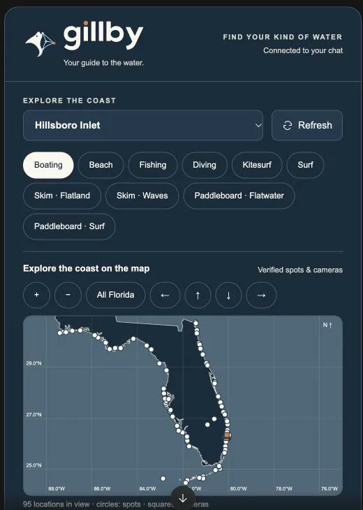

<h1 align="center">Gillby MCP</h1>

<p align="center">
  <b>Florida marine conditions for AI agents.</b> Tides, waves, wind, marine forecasts, hazards, red tide, rip currents, depth-aware boat routing and 84 verified coastal spots, through one remote MCP server and a public HTTP API.
</p>

<p align="center">
  <a href="https://registry.modelcontextprotocol.io/v0.1/servers?search=io.github.OneWave-AI%2Fgillby"></a>
  <a href="#claude-code-plugin"></a>
  <a href="https://www.gillby.com/api/v1/openapi.json"></a>
  <a href="LICENSE"></a>
</p>

Connect any MCP-compatible agent (Claude, ChatGPT, Cursor, Windsurf, Claude Code) to **Gillby**, a guide to Florida water. Public data needs **no API key, no login, no signup**: point your agent at `https://www.gillby.com/mcp` and ask.

<p align="center">
  
</p>

## Why Gillby exists

I'm newer to boating. I'm not from Florida, but I've been down here for years. My wife said it first: it was way too hard to get a good read on the weather without checking five different things, and when we asked an AI, it didn't have good answers on its own.

So I built Gillby. It's a hobby and a passion project: one map and one clock for a day on Florida water, plus this MCP server so your assistant can answer from real water data instead of guessing. More in [Why I built Gillby](https://www.gillby.com/blog/why-i-built-gillby).

> "Can I run Boca Inlet tomorrow morning?" · "Is the Gulf Stream close off Palm Beach?" · "Any red tide on the Gulf coast?" · "Will my 2.5 ft draft make it to the sandbar at low tide?"

## What makes it different

- **One map, one clock.** Wind, waves, tide, radar and lightning line up on the same timeline, per spot.
- **Chop for your boat.** Ride comfort accounts for boat size and hull, so a 21-foot center console gets a different answer than a big sportfish.
- **Bridge clearance at today's tide.** 97 bridges, with charted clearance adjusted for the NOAA tide prediction and the nearest live water-level gauge when it passes checks.
- **Calibrated rain and thunder chances.** Probabilities are recalibrated against airport observations, so a stated chance matches how often it actually rains.
- **A 16-day outlook with honest confidence.** Ensemble ranges and a trend against normal. From day 10 on, every day is labeled "Low confidence: trend only."
- **Sources stay attached.** Every answer carries source names, observation times, freshness and anything unavailable.

## Endpoint

```
https://www.gillby.com/mcp
```

Streamable HTTP transport.

| Access | What you get |
|---|---|
| **Public, no key** | Conditions, forecasts, tides, hazards, water quality, spots and places, activity scores, the latest 72 hours of history. 300 units/min per client. |
| **Free Gillby account** (OAuth) | Everything public, plus depth-aware route planning (`plan_route`, `plan_my_route`), saved vessel, places and trips, history up to 31 days, and 1,500 units/min. |
| **Commercial or bulk** | Separate agreement: info@onewave-ai.com |

## Quick connect

**Claude (claude.ai and Claude Desktop)**

1. Open Settings, then Connectors. Choose Add connector, then Add custom connector.
2. Enter `Gillby` as the name and paste the server URL above. Choose no sign-in for public conditions, then Add and Connect.
3. Start a new conversation with Gillby enabled and approve tool use when asked.

Connectors added on claude.ai also show up in Claude Desktop.

**ChatGPT**

1. Open Plugins (some accounts call it Apps or Connectors). Choose Add, then Add custom MCP server. Workspaces may need admin access.
2. Enter `Gillby` as the name, paste the server URL, and choose No authentication for public conditions. Create it, then Connect.
3. Start a new chat and select Gillby from your tools.

**Claude Code**

```bash
claude mcp add --transport http gillby https://www.gillby.com/mcp
```

**Cursor / Windsurf** — add to your MCP config:

```json
{
  "mcpServers": {
    "gillby": { "type": "http", "url": "https://www.gillby.com/mcp" }
  }
}
```

Try it: *"Use Gillby to check current conditions at Boca Inlet. Include source freshness and any unavailable data."* Full steps and troubleshooting: [connection guide](https://www.gillby.com/integrations).

## Claude Code plugin

This repo is also a Claude Code plugin: the Gillby MCP server plus 9 skills and 6 agents.

```
/plugin marketplace add OneWave-AI/gillby-mcp
/plugin install gillby@gillby
```

On Claude Code 2.1.275+ this is one step: `/plugin install gillby --marketplace OneWave-AI/gillby-mcp`.

Agents and evals call tools as `mcp__plugin_gillby_gillby__<tool>`. If you also connected Gillby as a claude.ai connector, the same tools appear twice; either works with the skills.

| Skills | Use for |
|---|---|
| `gillby-conditions` | Live read at any spot, compare spots |
| `gillby-go-no-go` | Boating / fishing / inlet trip call with departure windows |
| `gillby-route` | Depth-, tide- and bridge-aware routing, ICW-only |
| `gillby-fishing` | Gulf Stream, temp breaks, color, reefs, wrecks, tides |
| `gillby-beach-day` | Swim, rip risk, bacteria, sargassum, jellyfish, UV |
| `gillby-dive` | Visibility, currents, dive sites, protected areas |
| `gillby-surf-kite` | Surf, SUP, kite (rider wind range), skim, paddle |
| `gillby-water-quality` | Red tide, algae, Lake O, discharges, fish kills |
| `gillby-account` | Saved places, trips, vessel, settings (OAuth) |

| Agents | Role |
|---|---|
| `gillby-captain` | Trip planner, go / caution / no-go |
| `gillby-navigator` | Charts, depth, bridges, grounding risk |
| `gillby-fishing-guide` | Offshore and inshore fishing conditions |
| `gillby-beach-scout` | Best beach for swim, surf, kite, snorkel |
| `gillby-surf-guide` | Surf session windows for Florida and supported California spots |
| `gillby-water-quality-analyst` | Dated water-quality records, explained |

### Evals

`evals/` holds 6 cases (spot conditions, go/no-go, route asks for draft, kite asks for wind range, swim no-go with no wading, captain agent). MCP calls are answered by mocks recorded from the live server (`evals/mocks/gillby/`), so runs need no network access to Gillby.

```
claude plugin eval . --judge-model sonnet
```

## Tools

105 tools on the hosted server, generated from the live [tool reference](https://www.gillby.com/llms-full.txt). Start with `list_spots` and `get_conditions` with `view=summary`; that one result carries the forecast, tides, scores, advisories, hazards, lightning and source freshness.

<details>
<summary>All 105 tools by category</summary>

**Start here** (8)

| Tool | What it does |
|---|---|
| `get_briefing` | A short headline + <=60-word body written from the live data (numbers validated against the fact sheet; falls back to a template when no model is available). source says claude/openai/template. Rate limited: may call an LLM on a cold cache. |
| `get_conditions` | The full conditions bundle for a named spot: current waves (ft, s, deg FROM), wind (kt), tide (ft MLLW), water temp (F), activity scores with reasons, 7-day hourly forecast, hi/lo tides, best windows, NWS alerts, rip/red tide/bacteria hazards, lightning and an AI briefing. Kitesurf: kiteboarding contains rider-specific weather screening and unverified launch status; supply kiteStyle, kiteExperience, kiteMinWindKt and kiteMaxWindKt. No overall kite score or verified launch is implied. Activities: kite, surf, skim (flatland), skim-wave (wave riding), paddle (flatwater paddleboard), sup-surf (SUP surf). Skim scores are absent without shoreline observations; do not substitute other activity scores. Prefer view=summary unless you need every hour. boat=<id> adds boat-specific chop comfort. For an arbitrary lat/lon use get_point_conditions. Start here for a current spot question with view=summary: this single result includes forecast, tides, scores, advisories, hazards, lightning and source status. Avoid duplicate hazard/tide calls unless a needed detail is absent. For beach questions, sea-model wave heights and NWS breaking-surf heights measure different things; their difference alone is not a forecast conflict. A swim no-go must not be followed by a recommendation to wade. Interpretation: omit boat unless the user supplied or confirmed it. Describe lightning as flashes observed or not detected in the stated window, never a clear/safe guarantee. Report unavailable/QC-failed sources even when freshness.stale=false; fresh does not mean every source is usable. Model sea height is not breaking surf height. Tide heights at different local MLLW gauges do not establish relative channel depths. High tide is not necessarily slack current. For kitesurfing use get_conditions with kiteStyle (freeride/waves/foil), kiteExperience and rider-supplied kiteMinWindKt/kiteMaxWindKt. Read kiteboarding for weather screening, gust spread and explicitly unverified launch status. Never infer the rider wind range, legal launch access or rescue coverage. Activity keys: kite, surf, skim (flatland), skim-wave (wave riding), paddle (flatwater paddleboard), sup-surf (SUP surf). Skim suitability is unscored without shoreline observations; missing scores must not inherit another activity. Offshore wind can favor surf while increasing paddleboard drift risk. A point depth cannot prove route clearance. Do not invent detection percentages, future readings, vessel ownership, or app settings instructions. |
| `get_data_coverage` | Published dataset inventory and verified spot coverage; distinguishes unavailable data. |
| `get_health` | Rolls up whether the ingest worker is running, which feed families (ndbc, coops, nws, openmeteo, goes19, coastwatch...) have stale sources, government dataset status and the GLM lightning feed. status is ok \| degraded \| down; HTTP 503 only when down. Check this before trusting 'no data' from other tools. detail=true lists every source. |
| `get_release_updates` | Read the current Gillby release version, date, supported MCP protocol and dated changes shared by the API and MCP. API URL versions are separate from product release versions. |
| `get_source_status` | Fresh, stale, unavailable and QC-rejected sources used by spot conditions. |
| `get_spot` | A single spot record plus now.scores (go/caution/nogo per activity for the current hour) when the worker has scored it. |
| `list_spots` | Every named Florida spot the app scores, with its lat/lon, kind, region and the NOAA stations used for it. Use the returned id with conditions, forecast, tides, hazards and briefing tools. include=status adds the current-hour go/caution/nogo band per activity. Use this for a map of verified coastal spots: the MCP app panel renders an interactive Florida map with selectable spots, nearby camera markers and conditions. Coordinates are geographic locations, not safe navigation routes. |

**Forecast and conditions** (23)

| Tool | What it does |
|---|---|
| `compare_spots` | Compare current conditions for up to five verified comma-separated spot IDs. Partial failures remain explicit. |
| `get_activity_scores` | Hourly published activity scores with reasons and vetoes. Missing activity scores are unscored. |
| `get_air_temperature` | Air temperature for a verified spot over the next hours. Includes timestamp, source status and explicit nulls when unavailable. Water temperature is F; atmospheric visibility is mi, not underwater visibility; current sign follows the assigned station convention. |
| `get_chop` | Boat ride and chop (use get_chop_history for past trends) for a verified spot over the next hours. Includes timestamp, source status and explicit nulls when unavailable. Water temperature is F; atmospheric visibility is mi, not underwater visibility; current sign follows the assigned station convention. For chop history or trends use get_chop_history with a verified spot ID. Preserve recorded versus reconstructed provenance, native 0–10 index and labels, coverage and gaps. Never invent assistant-defined rough/calm thresholds or silently substitute wave/wind series for native chop. |
| `get_chop_history` | Gillby's native 0-10 chop series: the latest 72 hours publicly, up to 31 days with a free Gillby account (OAuth sign-in); daily mean/max, coverage and 7-day trends. Recorded outputs and historical model reconstructions are identified separately. Never replace these with assistant-defined Calm/Moderate/Rough cutoffs or fabricate gaps. For chop history or trends use get_chop_history with a verified spot ID. Preserve recorded versus reconstructed provenance, native 0–10 index and labels, coverage and gaps. Never invent assistant-defined rough/calm thresholds or silently substitute wave/wind series for native chop. |
| `get_cloud_cover` | Cloud cover for a verified spot over the next hours. Includes timestamp, source status and explicit nulls when unavailable. Water temperature is F; atmospheric visibility is mi, not underwater visibility; current sign follows the assigned station convention. |
| `get_currents` | Predicted inlet currents for a verified spot over the next hours. Includes timestamp, source status and explicit nulls when unavailable. Water temperature is F; atmospheric visibility is mi, not underwater visibility; current sign follows the assigned station convention. |
| `get_departure_windows` | Published best windows filtered by activity. No windows means none were supplied, not a guarantee that every other hour is unsafe. |
| `get_forecast` | Hourly forecast for a spot (or lat+lon) starting at `time` (default now) for `hours` hours: waves, swell/wind-wave split, wind, gusts, tide, current, precip/thunder chance, and go/caution/nogo scores with reasons per activity. Also returns 7 daily score rows and best windows. |
| `get_gulf_stream` | Approximate Gulf Stream edge for a verified spot. Preserve source sample dates and unavailable states. Satellite clarity is a relative index, not measured dive visibility. |
| `get_history` | Read stored observations or forecast history for source and var. Forecast source uses forecast:model and requires spot. Public access covers the latest 72 hours; a free Gillby account (OAuth sign-in) allows windows up to 31 days; up to 1000 points. Latest revision/run wins. Rejected and suspect rows are excluded; unreviewed rows retain quality metadata. This is a stored source archive. source=forecast:* returns model estimates or predictions, even when valid times are in the past; it does not establish observed rainfall. For measured historical daily precipitation use get_rainfall_history and preserve coverage. For chop trends use get_chop_history with recorded/reconstructed provenance and gaps. |
| `get_observations` | Actual buoy and station observations for a spot with timestamps. These may differ from blended forecast conditions. |
| `get_pressure` | Air pressure for a verified spot over the next hours. Includes timestamp, source status and explicit nulls when unavailable. Water temperature is F; atmospheric visibility is mi, not underwater visibility; current sign follows the assigned station convention. |
| `get_rain` | Rain forecast probability and amount for a verified spot over the next hours. Includes timestamp, source status and explicit nulls when unavailable. Water temperature is F; atmospheric visibility is mi, not underwater visibility; current sign follows the assigned station convention. |
| `get_rainfall_history` | Observed daily precipitation from NOAA NCEI GHCN-Daily at one of six selected Florida airport stations, not archived forecasts. Required station, start and end (YYYY-MM-DD); completed dates only, 1900 onward, at most 366 inclusive days per request. Public, no API key. Returns daily values in inches, original flags, coverage, monthly summaries and totals. totalIn is null for incomplete coverage; partialTotalIn is only the sum of accepted reported values. Trace is not dry. Presumed-zero, incomplete-period and quality-flagged reports are excluded. Reporting dates are station climate days, not UTC hours. A station does not measure rainfall at a nearby beach, inlet or across a region. Recent records may lag or be revised. Use for how much precipitation fell: NOAA observed station records, not forecast archives. Preserve station, reporting dates, trace days, missing/excluded counts and coverage. Never present partialTotalIn as a complete monthly/yearly total. Station rainfall is not an area-wide measurement. Use get_rain for future amounts and get_history source=forecast:om_weather_best var=precip_in only for archived model estimates. |
| `get_surf_forecast` | NWS surf zone forecast for a verified spot. Preserve source sample dates and unavailable states. Satellite clarity is a relative index, not measured dive visibility. |
| `get_thunder_forecast` | Thunderstorm forecast for a verified spot over the next hours. Includes timestamp, source status and explicit nulls when unavailable. Water temperature is F; atmospheric visibility is mi, not underwater visibility; current sign follows the assigned station convention. |
| `get_uv_forecast` | UV forecast for a verified spot over the next hours. Includes timestamp, source status and explicit nulls when unavailable. Water temperature is F; atmospheric visibility is mi, not underwater visibility; current sign follows the assigned station convention. |
| `get_visibility` | Atmospheric visibility for a verified spot over the next hours. Includes timestamp, source status and explicit nulls when unavailable. Water temperature is F; atmospheric visibility is mi, not underwater visibility; current sign follows the assigned station convention. |
| `get_water_temperature` | Water temperature for a verified spot over the next hours. Includes timestamp, source status and explicit nulls when unavailable. Water temperature is F; atmospheric visibility is mi, not underwater visibility; current sign follows the assigned station convention. |
| `get_wave_models` | Published wave-model series and model spread for a spot; absent models stay unavailable. |
| `get_waves` | Wave height, period and swell for a verified spot over the next hours. Includes timestamp, source status and explicit nulls when unavailable. Water temperature is F; atmospheric visibility is mi, not underwater visibility; current sign follows the assigned station convention. |
| `get_wind` | Wind and gusts for a verified spot over the next hours. Includes timestamp, source status and explicit nulls when unavailable. Water temperature is F; atmospheric visibility is mi, not underwater visibility; current sign follows the assigned station convention. |

**Tides, hazards and alerts** (11)

| Tool | What it does |
|---|---|
| `get_derelict_vessels` | Reported derelict vessels from the published agency dataset, with source and availability. Empty reports do not establish safe conditions. |
| `get_hazards` | Active NWS marine/coastal alerts (small craft, rip current, high surf, special marine, waterspout...) plus water hazards for a spot or lat+lon: rip current risk, red tide (FWC samples), bacteria (FDOH), sargassum, water clarity, king tide, Gulf Stream distance, lightning. Use before recommending swimming, diving or running an inlet. Interpretation: omit boat unless the user supplied or confirmed it. Describe lightning as flashes observed or not detected in the stated window, never a clear/safe guarantee. Report unavailable/QC-failed sources even when freshness.stale=false; fresh does not mean every source is usable. Model sea height is not breaking surf height. Tide heights at different local MLLW gauges do not establish relative channel depths. High tide is not necessarily slack current. For kitesurfing use get_conditions with kiteStyle (freeride/waves/foil), kiteExperience and rider-supplied kiteMinWindKt/kiteMaxWindKt. Read kiteboarding for weather screening, gust spread and explicitly unverified launch status. Never infer the rider wind range, legal launch access or rescue coverage. Activity keys: kite, surf, skim (flatland), skim-wave (wave riding), paddle (flatwater paddleboard), sup-surf (SUP surf). Skim suitability is unscored without shoreline observations; missing scores must not inherit another activity. Offshore wind can favor surf while increasing paddleboard drift risk. A point depth cannot prove route clearance. Do not invent detection percentages, future readings, vessel ownership, or app settings instructions. |
| `get_hurricane_history` | Search 26 completed seasons of NOAA NHC HURDAT2 best-track history (2000–2025), Atlantic and eastern/central Pacific. Includes tropical cyclones, not only hurricanes. Filter by basin, year range, name, storm ID, hurricane strength or recorded landfall. Paginated summaries by default; includeTrack=true returns UTC positions, sustained wind kt, pressure mb, status, special-event flags and 34/50/64 kt wind radii in nautical miles ordered NE, SE, SW, NW. Missing measurements are null. Landfall flags cover any coastline, not specifically the US. Finalized retrospective tracks are not forecasts; current 2026 advisories use get_hurricanes. Historical tracks alone do not measure local damage or future risk. |
| `get_hurricanes` | Active NHC tropical cyclones in the Atlantic and eastern/central Pacific. Returns position, maximum sustained wind (kt), pressure (mb), movement (degrees toward and kt), advisory timestamps and official advisory/forecast/cone links. Preserve stale/unavailable status. An empty active-storm list does not rule out developing systems or local hazards. The cone is not an impact boundary. Follow official local warnings. |
| `get_king_tide` | King tide forecast for a verified spot. Preserve source sample dates and unavailable states. Satellite clarity is a relative index, not measured dive visibility. |
| `get_lightning` | GOES-19 GLM lightning. With lat+lon: level (clear \| watch 10-25 mi \| danger < 10 mi in the last 5 min), nearest strike distance (mi) and time, strikes in 15 min, all-clear time (30 min after the last strike within 10 mi), SPC thunder outlook, and the last 30 min of flashes. Without lat/lon: status per spot. When the feed is stale, status is null and unavailableReason explains why (never a false 'clear'). Prefer list_spots for named spot coordinates. State no flashes detected in the observed window rather than no lightning exists. Stale/incomplete coverage means unknown. Do not supply detection rates that are absent from this result. Interpretation: omit boat unless the user supplied or confirmed it. Describe lightning as flashes observed or not detected in the stated window, never a clear/safe guarantee. Report unavailable/QC-failed sources even when freshness.stale=false; fresh does not mean every source is usable. Model sea height is not breaking surf height. Tide heights at different local MLLW gauges do not establish relative channel depths. High tide is not necessarily slack current. For kitesurfing use get_conditions with kiteStyle (freeride/waves/foil), kiteExperience and rider-supplied kiteMinWindKt/kiteMaxWindKt. Read kiteboarding for weather screening, gust spread and explicitly unverified launch status. Never infer the rider wind range, legal launch access or rescue coverage. Activity keys: kite, surf, skim (flatland), skim-wave (wave riding), paddle (flatwater paddleboard), sup-surf (SUP surf). Skim suitability is unscored without shoreline observations; missing scores must not inherit another activity. Offshore wind can favor surf while increasing paddleboard drift risk. A point depth cannot prove route clearance. Do not invent detection percentages, future readings, vessel ownership, or app settings instructions. |
| `get_marine_alerts` | Active and upcoming alerts for a spot, retaining start/end times and source links. |
| `get_navigation_notices` | USCG local notices to mariners from the published agency dataset, with source and availability. Empty reports do not establish safe conditions. |
| `get_park_alerts` | Coastal national park alerts and closures from the published agency dataset, with source and availability. Empty reports do not establish safe conditions. |
| `get_rip_risk` | Rip current risk for a verified spot. Preserve source sample dates and unavailable states. Satellite clarity is a relative index, not measured dive visibility. |
| `get_tides` | Predicted high and low tides (ft above MLLW, NOAA CO-OPS) for the next `days` days at a spot or lat+lon, the hourly tide height curve and inlet current (kt, + flood / - ebb), plus sunrise/sunset and moon phase. Times are ISO with the Eastern offset. Interpretation: omit boat unless the user supplied or confirmed it. Describe lightning as flashes observed or not detected in the stated window, never a clear/safe guarantee. Report unavailable/QC-failed sources even when freshness.stale=false; fresh does not mean every source is usable. Model sea height is not breaking surf height. Tide heights at different local MLLW gauges do not establish relative channel depths. High tide is not necessarily slack current. For kitesurfing use get_conditions with kiteStyle (freeride/waves/foil), kiteExperience and rider-supplied kiteMinWindKt/kiteMaxWindKt. Read kiteboarding for weather screening, gust spread and explicitly unverified launch status. Never infer the rider wind range, legal launch access or rescue coverage. Activity keys: kite, surf, skim (flatland), skim-wave (wave riding), paddle (flatwater paddleboard), sup-surf (SUP surf). Skim suitability is unscored without shoreline observations; missing scores must not inherit another activity. Offshore wind can favor surf while increasing paddleboard drift risk. A point depth cannot prove route clearance. Do not invent detection percentages, future readings, vessel ownership, or app settings instructions. |

**Routes, depth and boats** (7)

| Tool | What it does |
|---|---|
| `check_route_conditions` | Weather and marine conditions at up to five ordered spot IDs. Checks sampled stops only; does not create a navigable route or check depth, bridges, zones, or conditions between stops. |
| `get_boat` | A single boat record from the library. |
| `get_depth` | Actual NOAA ENC chart depth and optional DEM depth at a Florida coordinate, with charted hazards, channel context and restriction zones. A point check does not prove clearance along a route. Interpretation: omit boat unless the user supplied or confirmed it. Describe lightning as flashes observed or not detected in the stated window, never a clear/safe guarantee. Report unavailable/QC-failed sources even when freshness.stale=false; fresh does not mean every source is usable. Model sea height is not breaking surf height. Tide heights at different local MLLW gauges do not establish relative channel depths. High tide is not necessarily slack current. For kitesurfing use get_conditions with kiteStyle (freeride/waves/foil), kiteExperience and rider-supplied kiteMinWindKt/kiteMaxWindKt. Read kiteboarding for weather screening, gust spread and explicitly unverified launch status. Never infer the rider wind range, legal launch access or rescue coverage. Activity keys: kite, surf, skim (flatland), skim-wave (wave riding), paddle (flatwater paddleboard), sup-surf (SUP surf). Skim suitability is unscored without shoreline observations; missing scores must not inherit another activity. Offshore wind can favor surf while increasing paddleboard drift risk. A point depth cannot prove route clearance. Do not invent detection percentages, future readings, vessel ownership, or app settings instructions. |
| `list_boats` | Boats with published specs (LOA, beam, draft, deadrise, weight, hull type, fuel, cruise speed) and their sources. Pass a boat id to conditions/forecast/routes for boat-specific comfort and draft. The user's boat is contender-21-open-2008. |
| `list_bridges` | Search published bridges by name or west,south,east,north bbox. Verify access and operating details with the facility. Bridge data is published, not a live clearance calculation. |
| `list_sandbars` | Search published sandbars by name or west,south,east,north bbox. Verify access and operating details with the facility. Bridge data is published, not a live clearance calculation. For a named recreational/scored spot such as Lake Boca Sandbar, use list_spots first to get verified coordinates and IDs. This search is for places absent from the spot catalog; avoid repeated searches for an already cataloged spot. |
| `plan_route` | Requires a free Gillby account (OAuth sign-in). Chart-aware water routing between from/to spot IDs or lat,lon. Supply a confirmed library boat ID or measured draft, with beam, airDraft, ukc, bridgeMargin and speed overrides in feet/knots. Checks chart depths and tides along the geometry, samples across supplied beam, identifies bridges and restrictions, checks predicted MHW bridge clearance when data permits, and adds route weather samples. Does not infer saved vessel settings. Supports ordered via stops and a hard corridor=icw constraint. Cold charts may take 110 seconds. Interpretation: omit boat unless the user supplied or confirmed it. Describe lightning as flashes observed or not detected in the stated window, never a clear/safe guarantee. Report unavailable/QC-failed sources even when freshness.stale=false; fresh does not mean every source is usable. Model sea height is not breaking surf height. Tide heights at different local MLLW gauges do not establish relative channel depths. High tide is not necessarily slack current. For kitesurfing use get_conditions with kiteStyle (freeride/waves/foil), kiteExperience and rider-supplied kiteMinWindKt/kiteMaxWindKt. Read kiteboarding for weather screening, gust spread and explicitly unverified launch status. Never infer the rider wind range, legal launch access or rescue coverage. Activity keys: kite, surf, skim (flatland), skim-wave (wave riding), paddle (flatwater paddleboard), sup-surf (SUP surf). Skim suitability is unscored without shoreline observations; missing scores must not inherit another activity. Offshore wind can favor surf while increasing paddleboard drift risk. A point depth cannot prove route clearance. Do not invent detection percentages, future readings, vessel ownership, or app settings instructions. |

**Places and cams** (16)

| Tool | What it does |
|---|---|
| `find_anchorages` | Search published anchorages by name or west,south,east,north bbox. Verify access and operating details with the facility. Bridge data is published, not a live clearance calculation. |
| `find_beaches` | Search published beaches by name or west,south,east,north bbox. Verify access and operating details with the facility. Bridge data is published, not a live clearance calculation. |
| `find_boat_ramps` | Search published boat ramps by name or west,south,east,north bbox. Verify access and operating details with the facility. Bridge data is published, not a live clearance calculation. |
| `find_dive_sites` | Search published dive sites by name or west,south,east,north bbox. Verify access and operating details with the facility. Bridge data is published, not a live clearance calculation. |
| `find_fuel_docks` | Search published fuel docks by name or west,south,east,north bbox. Verify access and operating details with the facility. Bridge data is published, not a live clearance calculation. |
| `find_inlets` | Search published inlets by name or west,south,east,north bbox. Verify access and operating details with the facility. Bridge data is published, not a live clearance calculation. |
| `find_marinas` | Search published marinas by name or west,south,east,north bbox. Verify access and operating details with the facility. Bridge data is published, not a live clearance calculation. |
| `find_piers` | Search published piers by name or west,south,east,north bbox. Verify access and operating details with the facility. Bridge data is published, not a live clearance calculation. |
| `find_reefs` | Search published reefs by name or west,south,east,north bbox. Verify access and operating details with the facility. Bridge data is published, not a live clearance calculation. |
| `find_waterfront_dining` | Search published waterfront restaurants by name or west,south,east,north bbox. Verify access and operating details with the facility. Bridge data is published, not a live clearance calculation. |
| `find_wrecks` | Search published wrecks by name or west,south,east,north bbox. Verify access and operating details with the facility. Bridge data is published, not a live clearance calculation. |
| `get_camera_image` | Fetch a public camera JPEG with source timestamp metadata for the Gillby panel. Returns image bytes through MCP, without a browser network request. |
| `get_poi` | Look up a published coastal POI by its exact ID. Does not refresh facility details or calculate live bridge clearance. |
| `get_protected_areas` | Marine protected areas from the published agency dataset, with source and availability. Empty reports do not establish safe conditions. |
| `list_cams` | Live source links and credits near a spot or coordinate; archived imagery may be unavailable. |
| `search_pois` | Search public marine POIs. Optional cats is a comma-separated category list. Fuel prices and current bridge clearance are not verified. |

**Water quality and marine life** (19)

| Tool | What it does |
|---|---|
| `get_algae_reports` | Reported algae samples from the published agency dataset, with source and availability. Empty reports do not establish safe conditions. |
| `get_beach_bacteria` | Beach bacteria samples for a verified spot. Preserve source sample dates and unavailable states. Satellite clarity is a relative index, not measured dive visibility. |
| `get_canal_discharges` | Canal discharge and freshwater releases from the published agency dataset, with source and availability. Empty reports do not establish safe conditions. |
| `get_chlorophyll` | Satellite chlorophyll and water color from the published agency dataset, with source and availability. Empty reports do not establish safe conditions. |
| `get_coastal_sensors` | SECOORA coastal sensor observations from the published agency dataset, with source and availability. Empty reports do not establish safe conditions. |
| `get_coral_heat` | Coral heat stress and bleaching outlook from the published agency dataset, with source and availability. Empty reports do not establish safe conditions. |
| `get_fish_kills` | Reported fish kills from the published agency dataset, with source and availability. Empty reports do not establish safe conditions. |
| `get_florida_lakes` | Florida USGS lake monitoring inventory, levels with original vertical datum, temperature and storage where measured; historical stations and stale readings identified from the published agency dataset, with source and availability. Empty reports do not establish safe conditions. |
| `get_florida_rivers` | Florida NOAA river and water gauges, observed readings and separate forecast summaries from the published agency dataset, with source and availability. Empty reports do not establish safe conditions. |
| `get_jellyfish_observations` | Published Florida jellyfish, box jellyfish and man-of-war observations from OBIS and iNaturalist, with observation dates, uncertainty, observer credits and licenses. Includes official Boca Raton/Fort Lauderdale lifeguard-report links. Community records are not live beach warnings; no sightings does not establish absence. Man-of-war are siphonophores. Use bbox to narrow the sample; limit defaults to 20 (maximum 100). Shark, jellyfish and man-of-war records are dated published observations, not live tracking, beach warnings, abundance estimates or swimming-safety scores. Preserve observation dates, uncertainty, attribution and source availability. No records does not mean the animals are absent. Source checked time is not observation time. Man-of-war are siphonophores, not true jellyfish. Local lifeguard links are not ingested current warnings; check the source report date. Never apply NOAA's Chesapeake sea-nettle forecast to Florida. |
| `get_lake_okeechobee` | Lake Okeechobee stage and releases from the published agency dataset, with source and availability. Empty reports do not establish safe conditions. |
| `get_pollution_notices` | Pollution incident notices from the published agency dataset, with source and availability. Empty reports do not establish safe conditions. |
| `get_red_tide` | Red tide samples for a verified spot. Preserve source sample dates and unavailable states. Satellite clarity is a relative index, not measured dive visibility. |
| `get_sargassum` | Local sargassum risk for a verified spot. Preserve source sample dates and unavailable states. Satellite clarity is a relative index, not measured dive visibility. |
| `get_sargassum_outlook` | Sargassum research product availability from the published agency dataset, with source and availability. Empty reports do not establish safe conditions. |
| `get_shark_research` | Published Florida shark research occurrences with observation dates, location uncertainty, source credits and licenses. Historical acoustic detections and tag releases, not live shark tracking or beach warnings. No records does not mean sharks are absent. Use bbox to narrow the published sample; limit defaults to 20 (maximum 100). Shark, jellyfish and man-of-war records are dated published observations, not live tracking, beach warnings, abundance estimates or swimming-safety scores. Preserve observation dates, uncertainty, attribution and source availability. No records does not mean the animals are absent. Source checked time is not observation time. Man-of-war are siphonophores, not true jellyfish. Local lifeguard links are not ingested current warnings; check the source report date. Never apply NOAA's Chesapeake sea-nettle forecast to Florida. |
| `get_temperature_fronts` | Satellite sea temperature fronts from the published agency dataset, with source and availability. Empty reports do not establish safe conditions. |
| `get_usgs_water` | USGS flow, local gauge height, salinity and water temperature from the published agency dataset, with source and availability. Empty reports do not establish safe conditions. |
| `get_water_clarity` | Satellite water clarity for a verified spot. Preserve source sample dates and unavailable states. Satellite clarity is a relative index, not measured dive visibility. |

**Datasets** (2)

| Tool | What it does |
|---|---|
| `get_dataset` | The latest payload of one dataset from list_datasets, including sharks and jellyfish. These marine-life records are dated observations, not live beach warnings; no records does not imply absence. bbox filters list datasets; category filters USCG notices (e.g. bridge,hazard); homeZone=true limits discharges to the home zone; geometry=true includes MPA polygons. 503 when the dataset has never loaded. Shark, jellyfish and man-of-war records are dated published observations, not live tracking, beach warnings, abundance estimates or swimming-safety scores. Preserve observation dates, uncertainty, attribution and source availability. No records does not mean the animals are absent. Source checked time is not observation time. Man-of-war are siphonophores, not true jellyfish. Local lifeguard links are not ingested current warnings; check the source report date. Never apply NOAA's Chesapeake sea-nettle forecast to Florida. |
| `list_datasets` | Index of government datasets (SFWMD discharges, Lake O, USGS, CoastWatch chlorophyll / SST fronts, coral heat, USCG notices, derelicts, MPAs, algae, fish kills, shark research and jellyfish/man-of-war observations) with ok/stale/unavailable status and last-good time. |

**Your account (OAuth)** (16)

| Tool | What it does |
|---|---|
| `delete_my_place` | Delete a saved place. Repeat deletes return deleted=false. Requires your Gillby account and explicit account consent. |
| `delete_my_trip` | Delete a saved trip. Repeat deletes return deleted=false. Requires your Gillby account and explicit account consent. |
| `get_my_notification_settings` | Read notification preferences and actual delivery availability. Requires your Gillby account and explicit account consent. |
| `get_my_place` | Read one saved place. Requires your Gillby account and explicit account consent. |
| `get_my_settings` | Read saved vessel, preferences and notification settings. Missing vessel measurements remain null. Requires your Gillby account and explicit account consent. |
| `get_my_trip` | Read one saved trip. Requires your Gillby account and explicit account consent. |
| `get_my_vessel` | Requires OAuth login to your Gillby account. Reads only your saved vessel and route clearance settings. No writes and no other account access. |
| `list_my_places` | Read your saved places and favorites. Requires your Gillby account and explicit account consent. |
| `list_my_trips` | Read your saved trips. Requires your Gillby account and explicit account consent. |
| `plan_my_route` | Requires OAuth login. Uses your saved vessel, draft, air draft, speed, under-keel and bridge margins for actual chart routing. Explicit measurements override saved values. Never guesses missing required measurements. |
| `save_my_place` | Save a place or favorite. Supply a unique requestId and reuse it when retrying the same save; reused IDs with different input are rejected. Requires your Gillby account and explicit account consent. |
| `save_my_trip` | Save a trip. Supply a unique requestId and reuse it on retry. Saving does not assess navigation safety. Requires your Gillby account and explicit account consent. |
| `update_my_notification_settings` | Save notification preferences. Hosted delivery is in-app only; this does not enable push, email or notifications on this AI client. Requires your Gillby account and explicit account consent. |
| `update_my_place` | Update specified saved-place fields. Requires your Gillby account and explicit account consent. |
| `update_my_settings` | Update only specified vessel or preference fields. Requires your Gillby account and explicit account consent. |
| `update_my_trip` | Update specified trip fields; this does not recheck route safety. Requires your Gillby account and explicit account consent. |

**Other** (3)

| Tool | What it does |
|---|---|
| `get_fishing_heatmap` | Published Florida mahi, blue/white marlin, tarpon and snook evidence: dated NOAA commercial catches and research/community occurrences, source/license credits, coordinate uncertainty, seasonal record counts and configurable 0.25/0.10/0.05/0.02/0.01/0.005-degree heatmap cells. Historical records are not live fish locations, migration tracks, abundance, catch rates or catch probabilities. Sampling/fishing effort is uncorrected; absent records do not establish fish absence. from/to are inclusive YYYY-MM-DD observation dates; month pools all selected years. Source check time is not observation time. Recency weighting defaults to recent: exponential 365-day half-life based on observation dates, not source retrieval. weighting=historical gives equal weights. No upstream downloads on tool calls. Preserve species, observation dates, source credits, coordinate uncertainty, query coverage, partial/stale flags and fishing-effort bias. Heatmap color is record density, never fish abundance or catch odds. Commercial catches and occurrences must remain distinguishable. No generated migration paths. |
| `get_fishing_insights` | Published Florida mahi, blue/white marlin, tarpon and snook evidence: dated NOAA commercial catches and research/community occurrences, source/license credits, coordinate uncertainty, seasonal record counts and configurable 0.25/0.10/0.05/0.02/0.01/0.005-degree heatmap cells. Historical records are not live fish locations, migration tracks, abundance, catch rates or catch probabilities. Sampling/fishing effort is uncorrected; absent records do not establish fish absence. from/to are inclusive YYYY-MM-DD observation dates; month pools all selected years. Source check time is not observation time. Recency weighting defaults to recent: exponential 365-day half-life based on observation dates, not source retrieval. weighting=historical gives equal weights. No upstream downloads on tool calls. Preserve species, observation dates, source credits, coordinate uncertainty, query coverage, partial/stale flags and fishing-effort bias. Heatmap color is record density, never fish abundance or catch odds. Commercial catches and occurrences must remain distinguishable. No generated migration paths. |
| `get_fishing_records` | Published Florida mahi, blue/white marlin, tarpon and snook evidence: dated NOAA commercial catches and research/community occurrences, source/license credits, coordinate uncertainty, seasonal record counts and configurable 0.25/0.10/0.05/0.02/0.01/0.005-degree heatmap cells. Historical records are not live fish locations, migration tracks, abundance, catch rates or catch probabilities. Sampling/fishing effort is uncorrected; absent records do not establish fish absence. from/to are inclusive YYYY-MM-DD observation dates; month pools all selected years. Source check time is not observation time. Recency weighting defaults to recent: exponential 365-day half-life based on observation dates, not source retrieval. weighting=historical gives equal weights. No upstream downloads on tool calls. Preserve species, observation dates, source credits, coordinate uncertainty, query coverage, partial/stale flags and fishing-effort bias. Heatmap color is record density, never fish abundance or catch odds. Commercial catches and occurrences must remain distinguishable. No generated migration paths. |

</details>

## Hurricanes and historical tracks

Use `get_hurricanes` for active NHC cyclones and `get_hurricane_history` for **2000–2025** HURDAT2 history: **973 cyclones and 27,812 track records** in the Atlantic and eastern/central Pacific. Set `includeTrack=true` to retrieve a storm's recorded track from its first observation to its last, with UTC positions, wind, pressure and landfall flags. Filter by basin, season, name or exact storm ID; paginate summaries before requesting many full tracks. No public-data login or API key.

```json
{"name":"get_hurricane_history","arguments":{"query":{"id":"al122005","includeTrack":true}}}
```

Read the [complete hurricane API/MCP guide](HURRICANES.md), [app](https://www.gillby.com/hurricanes) and [live input schemas](https://www.gillby.com/integrations/tools#get_hurricane_history). Finalized history ends in 2025; ongoing-season advisories use the active tool. Tracks are retrospective observations, not forecasts or damage estimates.

## HTTP API

Everything is also available over ordinary HTTP GET. Public endpoints need no key; account endpoints, route planning and history older than 72 hours need OAuth with a free Gillby account.

```bash
curl --fail-with-body 'https://www.gillby.com/api/v1/conditions?spot=boca-inlet&view=summary'
```

- Developer guide, examples, error codes and versioning: https://www.gillby.com/developers
- OpenAPI schema: https://www.gillby.com/api/v1/openapi.json
- AI-readable docs: [llms.txt](https://www.gillby.com/llms.txt) and [llms-full.txt](https://www.gillby.com/llms-full.txt)

**Rate limits.** About 60 data requests per minute per client, shared between the API and MCP. Over the limit you get HTTP 429 with `Retry-After`; honor it and back off. A request without a spot returns 400 `spot_required`.

## Data and credits

Data comes from NOAA and NWS (forecasts, marine zones, alerts), NDBC buoys, NOAA CO-OPS tides and water levels, NOAA GOES-19 lightning, Open-Meteo and ECMWF/GFS models, NOAA CoastWatch, USGS, FWC, FDEP, FDOH, USCG and other public sources. Each response names the sources it used.

Gillby is for planning, not navigation. Check official charts, notices and conditions on the water.

## License

The plugin, skills, agents, evals and docs in this repo are [MIT](LICENSE). The Gillby name and logo, the hosted service, its source code and the data it returns are not; see [LICENSE](LICENSE) for the scope. Changes are listed in the [changelog](CHANGELOG.md).

---

Built by Gabe Keding.
